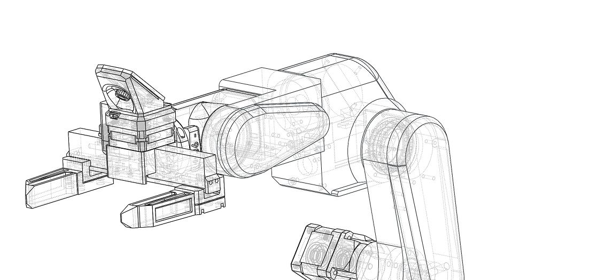
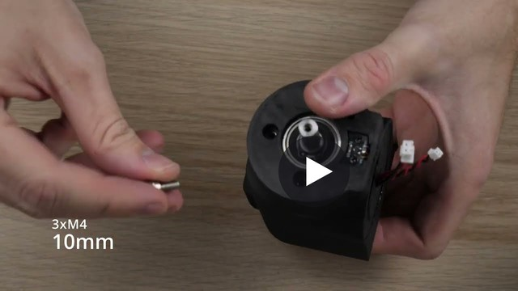

  

<h1 align="center">PAR6</h1>

  <b>Open-source 3D-printed collaborative robot arm.</b> 
  Designed for embodied and physical AI, safety and ease of use.

  <a href="https://docs.google.com/forms/d/e/1FAIpQLSfJVBVM5K6rCrFRtpijmTBLeePUdGDxUlWBni1VqBrAZwRCwg/viewform"><b>Join the beta</b></a>&nbsp;&nbsp;·&nbsp;&nbsp;
  <a href="https://docs.source-robotics.com/par6/"><b>Documentation</b></a>&nbsp;&nbsp;·&nbsp;&nbsp;
  <a href="https://youtu.be/3Rrd6hjBnM4"><b>Assembly video</b></a>&nbsp;&nbsp;·&nbsp;&nbsp;
  <a href="https://docs.source-robotics.com/par6/latest/par6/cad-files/"><b>Downloads</b></a>&nbsp;&nbsp;·&nbsp;&nbsp;
  <a href="https://discord.com/invite/prjUvjmGpZ"><b>Discord</b></a>

  
  
  

| **6 axes** | **6 STEPFOC** | **Raspberry Pi 5** |
|:-:|:-:|:-:|
| NEMA 17 steppers | closed-loop drives, one per joint | in the Robot Control Box |

## Project overview

<table>
  <tr>
    <td width="55%" valign="middle">
      PAR6 is a 3D-printed collaborative robot arm platform designed for research, education, and rapid
      prototyping in physical AI. The project combines mechanical design files, assembly documentation, and
      software resources to support full-stack robotics development.
        
      <a href="https://youtu.be/3Rrd6hjBnM4"><b>&#9654;&#xFE0E;&nbsp; Watch the PAR6 assembly video</b></a>
    </td>
    <td width="45%" valign="middle">
      
    </td>
  </tr>
</table>

Key focus areas:

- Embodied AI and physical AI experiments and validation
- Teleoperation workflows and human-in-the-loop control
- Learning from demonstration (LfD) pipelines
- Imitation learning and dataset generation
- VLA-style data collection for AI-native robotics
- Accessible robotics research through open hardware and open documentation

## Beta

> [!NOTE]
> This is a beta release: the instructions, the code and the 3D print files may change in the future and are not
> yet final. If you want to be part of the beta testing, fill in the
> [beta sign-up form](https://docs.google.com/forms/d/e/1FAIpQLSfJVBVM5K6rCrFRtpijmTBLeePUdGDxUlWBni1VqBrAZwRCwg/viewform).

By building and using this system, you acknowledge that it is still under active development and may contain
errors, incomplete features, or design issues. You are doing so entirely at your own risk and responsibility.

This project may require troubleshooting, modifications, and technical knowledge. Proceed only if you are
comfortable working with electronics, mechanical systems, and software in a development-stage environment.

**Beta feedback and support.** Since this project is currently in beta, feedback is highly appreciated. If you find any
mistakes, bugs, or unclear parts, please report them, including issues in the documentation, the BOM and assembly
documentation, the source code, and the STL and other 3D print files. Please
[open an issue](https://github.com/Source-Robotics/PAR6-Collaborative-Robot-Arm/issues), send us a message on
[Discord](https://discord.com/invite/prjUvjmGpZ), or contact us via email
([Getting help](https://docs.source-robotics.com/par6/latest/support/)) with as much detail as possible, so we can
fix it quickly.

<b>Contributing and open TODOs</b>

### Contributing

Use GitHub issues to track open work before starting a pull request:

- Open one issue per bug, task, or feature request.
- Keep each pull request focused on one logical change.
- Link the related issue in the pull request description.
- Describe what changed and what you tested.
- For larger changes, open an issue first and agree on the approach before coding.

How you can contribute:

- Review and triage issues: reproduce bugs reported by others, spot duplicates, improve descriptions, and help users
  who need support.
- Submit fixes: pick an open issue or feature request and submit a pull request with your implementation.
- Test pull requests: run proposed changes and report your results; testing on real hardware is invaluable.
- Review contributions: help others by reviewing code and suggesting better implementation approaches.
- Improve documentation: write new content or polish what's already there.

More details on how to contribute:
[the Source Robotics contributing guide](https://github.com/Source-Robotics/.github?tab=contributing-ov-file).

### Open TODOs

Open tasks that contributors can pick up. Before starting work, please open or comment on the related issue so work
is not duplicated.

| Area | Task | Status |
| :--- | :--- | :---: |
| Documentation | Typos, readability changes, structure for the .md files | Open |
| Documentation | Finalize the BOM: fix links, reference images, exact number of parts... | Open |
| Hardware | Create .3mf print files for the robot (follow the 3D print table) | Open |
| Hardware | Issues in 3D print / model files | Open |
| Hardware | Recommendations for easier assembly of the robot | Open |
| Software | TODO | Open |

Status options: `Open`, `In progress`, `Needs review`, `Blocked`, `Done`.

## Start here

| I want to | Go to |
|---|---|
| **Join the beta** | [beta sign-up form](https://docs.google.com/forms/d/e/1FAIpQLSfJVBVM5K6rCrFRtpijmTBLeePUdGDxUlWBni1VqBrAZwRCwg/viewform) · [beta guide](beta_guide.md) |
| **Build my own** | [BOM](BOM/BOM.md) · [print files](3D%20Print%20Files/) · [print table](3D%20Print%20Files/PAR6%20Print%20Table.pdf) · [cables](Assembly%20manual/Building_cables.md) · videos: [the arm](https://youtu.be/3Rrd6hjBnM4), [robot cable](https://youtu.be/QlNfWAga1l0), [CAN and power wires](https://youtu.be/GOb1vQsjfOs) |
| **Build the control box** | [RCB-Robot-Control-Box](https://github.com/Source-Robotics/RCB-Robot-Control-Box) (PAR6 needs it) · [assembly video](https://youtu.be/qAzd839ixuw) |
| **Set it up and make it move** | [drive setup](beta_guide.md) (beta guide) · [control box software setup](https://docs.source-robotics.com/par6/latest/rcb/05-software-setup/) |
| **Program it** | [Programming Guide](https://docs.source-robotics.com/par6/latest/programming/) · [RCB-Runtime](https://github.com/Source-Robotics/RCB-Runtime) (with the Python client and the dashboard) |
| **Simulate it** | [URDF and MuJoCo models](par6_description/) · [Simulation and AI Guide](https://docs.source-robotics.com/par6/latest/simulation/) |
| **Add a gripper** | [MSG](https://github.com/Source-Robotics/MSG-compliant-AI-stepper-gripper) · [SSG-48](https://github.com/Source-Robotics/SSG-48-adaptive-electric-gripper) · [pneumatic](BOM/BOM.md#pneumatics-optional) |

## In this repository

| Folder | What is in it |
|---|---|
| [`3D Print Files`](3D%20Print%20Files/) | every printed part as STL, one folder per section from the end effector to the base; the print plates as 3MF for 250 x 210 and 250 x 250 mm beds; the print table (PDF) |
| [`BOM`](BOM/) | the bill of materials, with shop links and reference images, the custom and machined parts, and a part-by-part comparison with the PAROL6 BOM (xlsx) |
| [`Assembly manual`](Assembly%20manual/) | building the cables, the CAN and 24 V power wire diagrams, the gearbox datasheets |
| [`par6_description`](par6_description/) | the model guide: URDF and MuJoCo downloads for all six robot and end-effector configurations, from [robot_descriptions](https://github.com/Source-Robotics/robot_descriptions) |
| [`Photos`](Photos/) | wireframe drawings of the arm |
| [`beta_guide.md`](beta_guide.md) | the beta: the operating system image, the beta control box mainboards, setting up the drives |

There is no release yet: while PAR6 is in beta, the files on the main branch are the latest. The manual's
[Downloads and files](https://docs.source-robotics.com/par6/latest/par6/cad-files/) page links the software and
firmware that go with them. The model files themselves live in
[robot_descriptions](https://github.com/Source-Robotics/robot_descriptions): download the ZIP for your simulator from
the [model guide](par6_description/); this repository needs no model submodule or recursive clone.

## Community

Ask in [Discussions](https://github.com/orgs/Source-Robotics/discussions), chat on
[Discord](https://discord.com/invite/prjUvjmGpZ), report a bug in
[Issues](https://github.com/Source-Robotics/PAR6-Collaborative-Robot-Arm/issues). See what others built in the
[community projects](https://docs.source-robotics.com/par6/latest/support/community/), and follow Source Robotics:

## References and acknowledgments

PAR6 works with:

- [RCB-Robot-Control-Box](https://github.com/Source-Robotics/RCB-Robot-Control-Box): the Robot Control Box, the
  controller PAR6 needs
- [RCB-Runtime](https://github.com/Source-Robotics/RCB-Runtime): the control box's software, with the Python client
  and the dashboard
- [STEPFOC-stepper-controller](https://github.com/Source-Robotics/STEPFOC-stepper-controller): the closed-loop
  stepper drives in the joints
- [robot_descriptions](https://github.com/Source-Robotics/robot_descriptions): the maintained URDF and MuJoCo models

PAR6 builds on:

- [Robotics Toolbox for Python](https://github.com/petercorke/robotics-toolbox-python) by Peter Corke, used by the
  runtime
- [ros-realtime-rpi4-image](https://github.com/ros-realtime/ros-realtime-rpi4-image/releases/tag/24.04.2_v6.8.4-rt11-raspi_ros2_jazzy):
  the real-time operating system image for the control box's Raspberry Pi

## Safety, liability and disclaimer

This project includes experimental software, hardware designs, and assembly documentation that are still under
development and may contain bugs, errors, or incomplete features. By using, building, or modifying this project, you
acknowledge that:

* You use this project entirely at your own risk
* You are solely responsible for safe assembly, testing, and operation
* No guarantee is made regarding correctness, safety, or reliability
* The authors are not responsible for any damage, injury, or loss resulting from the use or misuse of this project
* Hardware performance and safety depend on user assembly, component quality, calibration, and handling, which cannot be guaranteed
* This project is provided “as is.” If you choose to build a device yourself using these files, designs, or instructions, you do so without any warranties or guarantees, including regarding safety, reliability, or suitability for any particular purpose.

> [!WARNING]
> THIS PROJECT INVOLVES LETHAL VOLTAGES AND OTHER SERIOUS HAZARDS THAT CAN CAUSE SEVERE INJURY. YOU MUST READ THE FULL [SAFETY WARNING AND DISCLAIMER DOCUMENT](SAFETY_WARNING_AND_DISCLAIMER.md)  BEFORE USING ANY PROJECT FILES. BY PROCEEDING, YOU ACKNOWLEDGE AND ACCEPT ALL RISKS AND AGREE TO USE THIS PROJECT ENTIRELY AT YOUR OWN RESPONSIBILITY.

## Licensing

**[CERN Open Hardware Licence Version 2 - Strongly Reciprocal](LICENSE)**

## Versions

There is no release yet. What the beta is, and what works with it: [VERSIONS.md](VERSIONS.md).
